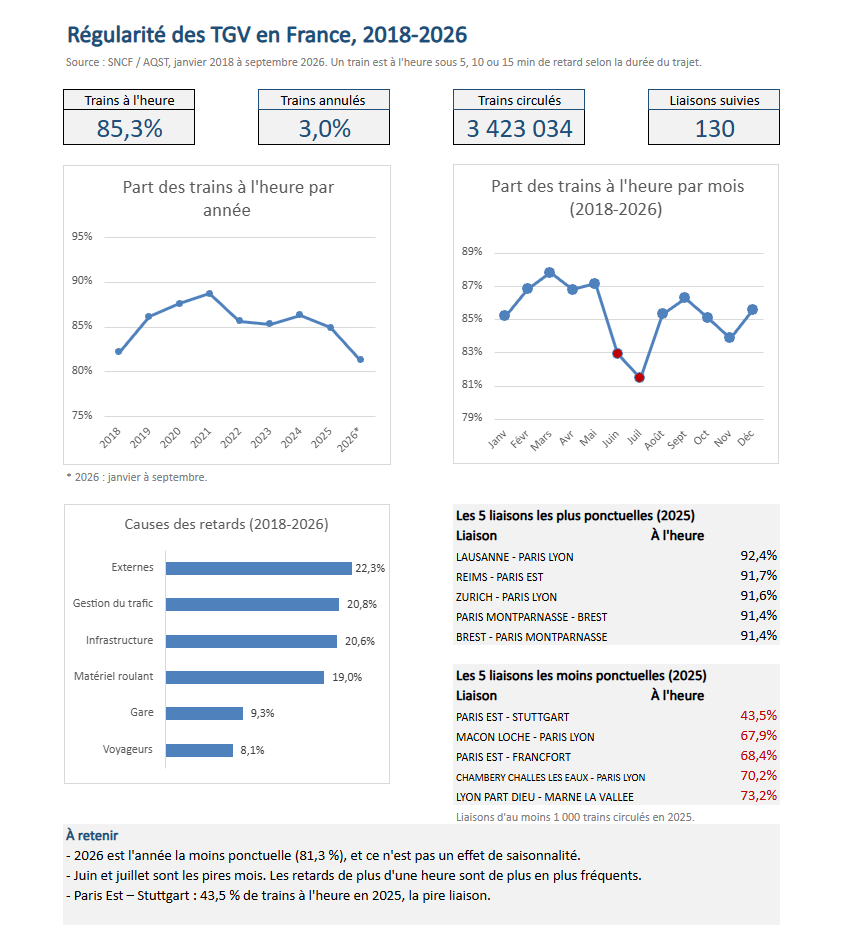

# French High-Speed Train (TGV) Punctuality: an Excel Analysis

> Personal project built with **Excel (pivot tables, dynamic array formulas, charts), Python (Pandas) and Git**

An analysis of the monthly punctuality of every TGV route in France from January 2018 to September 2026: how punctuality changed over time, which routes and months are the most difficult, what causes delays, and what happened during Covid.

## Key figures

| Indicator | Value |
| --- | --- |
| Period | January 2018 to September 2026 |
| Trains that ran | 3,423,034 |
| Trains on time | **85.3%** |
| Trains cancelled | **3.0%** |
| Routes | 130 |

## Business questions

1. How has TGV punctuality changed from 2018 to 2026?
2. Which routes are the most and the least punctual?
3. What are the main causes of delays, and have they changed?
4. Are some months of the year more difficult than others?
5. Are long trips less punctual than short ones?
6. Is the International service less punctual than the National one?
7. How much did Covid reduce traffic, and how fast did it recover?
8. Are long delays (more than 30 and 60 minutes) becoming more frequent?

## How a train is "on time"

The SNCF counts a train as on time if it arrives with a delay below a threshold that depends on the trip length:

| Trip length | Threshold |
| --- | --- |
| Less than 1h30 | 5 minutes |
| 1h30 to 3h | 10 minutes |
| More than 3h | 15 minutes |

The SNCF also states that the national rate is **not the average of the route rates**. Every rate in this project is therefore calculated by adding up the trains first (on time, ran) and then dividing, never by averaging percentages.

## Key findings

**1. Punctuality is at its lowest in 2026.** 81.3% of trains were on time from January to September 2026, against 82.2% in 2018 and 85.0% in 2025. This is not a seasonal effect: over the same months, the 2018-2025 average is about 85.5%.

**2. The best years were the Covid years.** 2021 (88.7%) and 2020 (87.6%) had the fewest trains. A possible explanation is that fewer trains mean fewer delays passed from one train to the next. This is an association, not a proven cause.

**3. Cancellations have dropped sharply**, from 7.6% in 2018 (a long SNCF strike in spring 2018) to about 1% since 2024.

**4. The least punctual route in 2025 is Paris Est - Stuttgart: 43.5%**, fewer than one train in two on time. Paris Est - Frankfurt is third (68.4%). The direction matters: Frankfurt - Paris Est reaches 83.7%. The most punctual routes go to Switzerland (Lausanne 92.4%, Zurich 91.6%), Reims and Brittany.

**5. No single cause explains delays.** External causes (22.3%), traffic management (20.8%), infrastructure (20.6%) and rolling stock (19.0%) each account for about a fifth of delays. Traffic management became the first cause in 2025 (24.5%).

**6. Early summer is the most difficult period.** July (81.5%) and June (83.0%) are the two worst months; March (87.8%) and May (87.2%) are the best.

**7. The official rate hides long delays on long trips.** With the SNCF thresholds, punctuality is almost the same for short and long trips (84.5% to 85.8%). With one common rule, delays of more than 60 minutes are 2.6 times more frequent on trips of more than 3 hours (2.96%) than on trips under 1h30 (1.15%).

**8. Delays are becoming longer.** Among late trains, the share delayed by more than one hour rose from 11.0% in 2018 to 14.6% in 2023 and 16.7% in 2026.

**9. Covid:** in April 2020, only 10.4% of the trains of April 2019 were planned. Traffic was back above its 2019 level from August 2021.

## Data quality

The data was checked with Python before the analysis (`preparer.py`, `inspecter.py`), and several issues were found:

| Issue found | Explanation | How it was handled |
| --- | --- | --- |
| 42 apparent duplicates (same month, same route) | Not real duplicates: the same route exists in the National and International services | Kept; a row is identified by month + service + route |
| 63 rows with more cancelled trains than planned trains | April to June 2020 (lockdown): 0 trains planned but cancellations counted | Kept, but excluded from rates |
| 10 rows with 0 trains planned and 0 cancelled | The route did not run that month | Excluded from rates (73 rows in total) |
| 272 rows where all delay causes are 0% | 192 months without any delay; 80 months with delays but no cause recorded | Excluded from the cause analysis |
| 354 rows (January to March 2025) with more delays over 60 min than over 30 min | The "over 30 min" column is 0 or even negative (-4) for these months: an error in the source | 2025 excluded from the long-delay analysis |
| An unclear column ("average delay if the route competes with flights") | Equal to the overall average delay in 2,135 rows out of 12,907 | Removed |
| 2 empty comment columns | Never filled | Removed |

Three consistency checks found errors during the analysis:

1. **A 43% punctuality rate on Paris Est - Strasbourg**, a major route, looked wrong. The rate column was shifted by one row; after the fix, the route is at 89%.
2. **December 2020 at 156% of December 2019** looked wrong. December 2019 was itself reduced by a strike, so it is not a valid reference.
3. **Delays over 60 minutes rising by 67% in 2025** while delays over 30 minutes were falling is impossible. A Python check found 354 inconsistent rows, all from January to March 2025.

## What I built

**Data preparation (Python, Pandas):** loading the CSV, removing empty and unclear columns, shorter column names, real dates, validity flags (`Valide_taux`, `Causes_renseignees`) and consistency checks.

**Excel workbook:**
- An Excel table with calculated columns (trains that ran, trains on time, rates, year, month, trip length class, number of late trains per cause).
- One pivot table per business question (`Q1_Evolution` to `Q8_Gros_retards`), with rates calculated from the sums.
- Rankings with dynamic array formulas: `FILTRE`, `TRIER`, `PRENDRE` (FILTER, SORT, TAKE).
- A one-page dashboard: 4 KPIs calculated from the data, 3 charts and the best and worst routes of 2025.

## Limitations and next steps

- 2026 only covers January to September.
- The cause categories change sharply in 2026 (external causes 29.8%, station 19.1%, infrastructure 10.8%). This may be a change in how causes are classified; it should be checked month by month.
- The number of International trains rises sharply in 2025, and at least one route (Bellegarde - Paris Lyon) moved to the International service that year. Part of the change may come from this reclassification.
- Next steps: compare punctuality by axis (South-East, Atlantic, North, East), and link the monthly results to weather data.

## Repository structure

| Path | Content |
| --- | --- |
| `tgv_analyse.xlsx` | Excel workbook: data, analyses and dashboard |
| `preparer.py` | Data preparation and quality checks |
| `inspecter.py` | Detailed checks of the anomalies |
| `notes_qualite.md` | Data quality notes (in French) |
| `images/` | Dashboard screenshot |

## How to run

1. Download the CSV from the source below and save it as `regularite-mensuelle-tgv.csv`.
2. Run `pip install pandas openpyxl`, then `python preparer.py`. It creates the cleaned data file `tgv_regularite.xlsx`.
3. Open `tgv_analyse.xlsx` in Excel to see the analyses and the dashboard.

## Data source

[Régularité mensuelle TGV par liaisons](https://www.data.gouv.fr/datasets/regularite-mensuelle-tgv-par-liaisons), SNCF / AQST, file updated on 2 October 2026.

---

**Furkan Mutlu** - [github.com/Furkan-Mtl](https://github.com/Furkan-Mtl)
